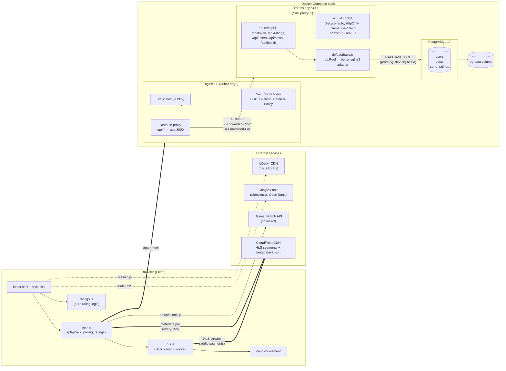

# System Architecture

End-to-end view of the Radio Calico runtime: browser, the nginx + Express + PostgreSQL stack inside Docker Compose, and the external services the browser talks to directly.

## Things the diagram is encoding

- **Two independent CloudFront flows.** The audio stream (handled by `hls.js`, ~24-bit / 48 kHz HLS segments) and the metadata polling (every 15 s, plain JSON) hit the same CDN host but are completely separate from the API request flow that goes through nginx.
- **iTunes runs browser-side, not server-side.** Cover-art lookups never touch the Express app — the browser calls `itunes.apple.com` directly and memoizes results in `artworkCache`.
- **`trust proxy: 1`** is the joint Express + nginx contract that makes `req.secure` (drives cookie `Secure`) and `req.ip` correct behind nginx. `X-Real-IP` is what the token-IP derivation actually reads because the leftmost `X-Forwarded-For` entry is client-spoofable.
- **DB layer is dual-mode.** Same `await db.query(...)` API; under the hood `db/database.js` picks `pg.Pool` when `DATABASE_URL` is set, otherwise a `better-sqlite3` adapter (dev / bare-metal only — `better-sqlite3` is stripped from the production image).
- **The `pg-data` volume** is what makes the PostgreSQL container's data survive `docker compose down`; SQLite in dev uses a host bind-mount at `db/radiocalico.db` instead.

See also: [`rating-flow.md`](./rating-flow.md) for the per-request sequence behind a rating submission.
