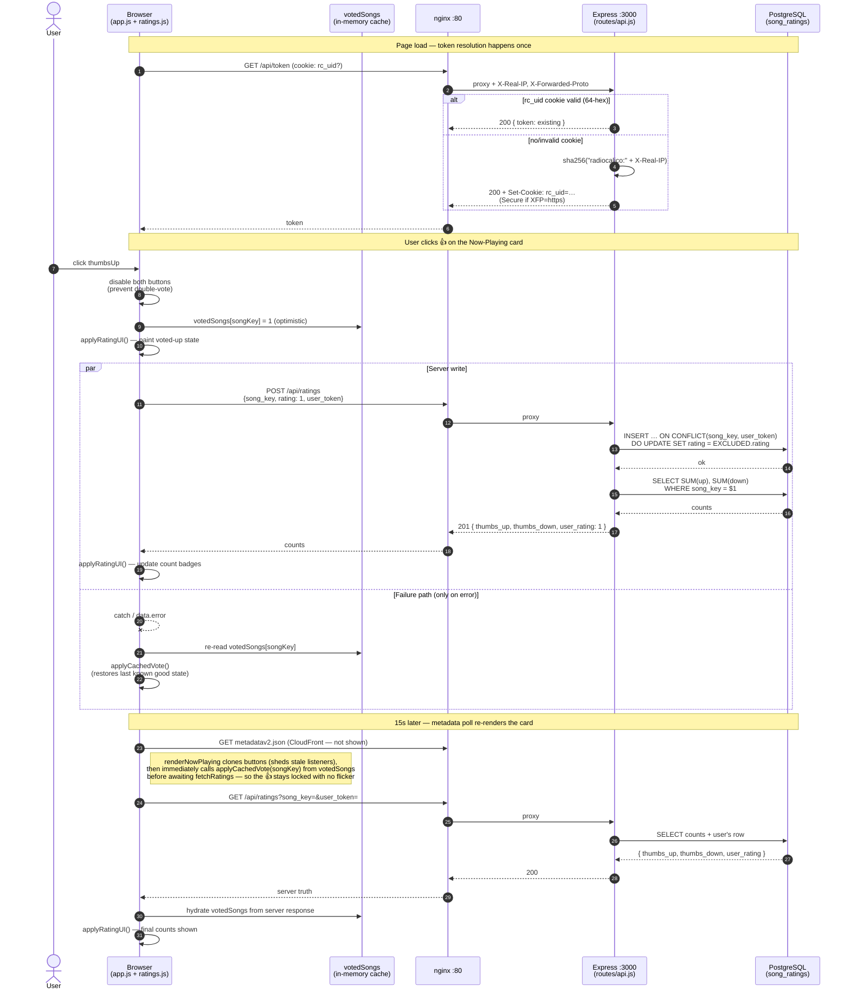

# Rating-Submit Flow

Sequence diagram for the path a thumbs-up / thumbs-down vote takes from a button click to PostgreSQL and back, including the optimistic-UI cache, the cookie-resolved user token, and the `ON CONFLICT DO UPDATE` upsert.

## What this diagram is meant to surface

- **The optimistic-UI contract.** `votedSongs` is updated *before* the POST is in flight (step 4), so the UI feels instant. Any error path (the `par … and` failure branch) reverts via `applyCachedVote` reading the cache — never a raw `disabled = false`, so vote-changing across cards still works.
- **Why the metadata-poll re-render doesn't flicker.** When the 15-second poll triggers `renderNowPlaying`, the code clones-and-replaces the buttons to drop stale click handlers, then synchronously calls `applyCachedVote(songKey)` *before* awaiting `fetchRatings`. The "locked 👍" state is restored from cache during the async gap, then `applyRatingUI` overlays server counts when they arrive.
- **`ON CONFLICT DO UPDATE`** is what lets the same `(song_key, user_token)` pair flip from 👍 to 👎 in a single atomic statement — no `SELECT` → `UPDATE`-or-`INSERT` race window.
- **Token resolution happens exactly once per page load**, gated before any rating call (the `(async () => { … })()` block in `app.js`). Every subsequent rating request carries the cached `USER_TOKEN`, so the cookie round-trip isn't repeated.

See also: [`architecture.md`](./architecture.md) for the system-wide component view.
